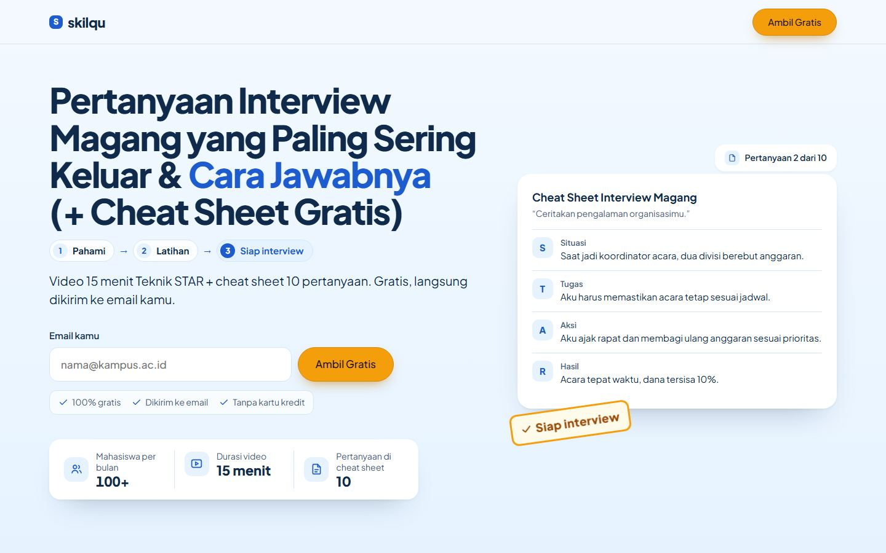

# Skilqu: Landing Page Cheat Sheet Interview Magang

Landing page *mobile-first* untuk **Skilqu Free Starter Kit**, dibuat untuk tugas Mata Kuliah Pemasaran Digital (Modul 2: Landing Page & Usability Testing), Inovasi Digital, Departemen Sistem Informasi, ITS. Skilqu adalah studi kasus dari modul.

**Live:** https://skilqu-interview-magang.netlify.app

> [!IMPORTANT]
> **Ini hanya tugas kuliah, bukan produk atau layanan sungguhan.**
> Skilqu adalah studi kasus fiktif dari modul mata kuliah. Tidak ada perusahaan, kursus, video, cheat sheet, atau paket Skilqu Pass yang benar-benar dijual.
> Angka di halaman (misalnya 100+ mahasiswa per bulan dan harga Rp49.000/bulan) berasal dari data *business case* modul, bukan data nyata.
> Pendaftaran (lewat Lynk.id) hanya dipakai untuk pengujian tugas. Mohon jangan mengisi data pribadi yang sensitif.



## Tentang proyek

- **Tujuan:** satu tujuan konversi, yaitu pengunjung mendaftar Free Starter Kit (Rp0): video 15 menit Teknik STAR dan cheat sheet 10 pertanyaan interview magang. Paket lanjutan Skilqu Pass (Rp49.000/bulan) dikenalkan setelahnya.
- **Target:** mahasiswa tingkat akhir dan fresh graduate (persona "Nadya", 21 tahun). 85% membuka dari HP.
- **KPI:** Landing Conversion Rate = pendaftar ÷ pengunjung × 100%. Baseline 5%, target ≥ 8%.

## Struktur halaman (5-Section Mobile Framework)

1. **Hero:** H1 dari riset SEO Modul 1, tombol CTA langsung di hero, dan kartu cheat sheet STAR sebagai mockup produk.
2. **Problem & Agitation:** 3 momen yang bikin interview gagal, ditutup kalimat yang menyala kata demi kata saat di-scroll.
3. **Solution & Inside Preview:** perbandingan jawaban biasa vs Teknik STAR (bisa diklik per bagian), isi Starter Kit, dan tabel YouTube vs Bootcamp vs Skilqu.
4. **Trust & FAQ:** cuplikan cheat sheet yang diburamkan, info transparan Skilqu Pass, dan 5 FAQ.
5. **Final CTA:** 3 langkah cara ambil dan tombol ke produk Rp0 di Lynk.id (sejak Modul 3; sebelumnya form Google Form). Ditambah bonus video tips interview dari YouTube sebelumnya.

## Fitur

- Satu kolom di HP, H1 31px, teks isi 16–18px, dan target sentuh minimal 44px.
- Tombol CTA amber `#F59E0B` terlihat di layar pertama dan diulang di bawah. Ada tombol sticky di HP yang menyingkir saat bagian akhir terlihat.
- Semua tombol "Ambil Gratis" membuka produk Free Starter Kit Rp0 di Lynk.id. Parameter `utm_*` dari link s.id (Hook A/B, Modul 3) ikut diteruskan ke link Lynk.id.
- Motion halus: bagian muncul saat di-scroll, kartu terangkat saat disorot, centang tabel, kilau tombol, serta stempel "Siap interview" dan "Terkirim". Semua motion berhenti kalau pengguna memakai mode "kurangi gerakan".
- SEO on-page: title tag, meta description, canonical, dan Open Graph untuk pratinjau link.

## Teknologi

- HTML, CSS, dan sedikit JavaScript, tanpa framework dan tanpa build step.
- Font: Plus Jakarta Sans (Google Fonts). Ikon: SVG garis.
- Hosting: Netlify. Data pendaftar: Lynk.id.
- Sistem tata letak dan motion memakai kit dari [taste-skill](https://github.com/Leonxlnx/taste-skill) (lisensi MIT, lihat `assets/LICENSE-taste-skill.txt`).

## Struktur file

```
index.html        halaman utama
privacy.html      kebijakan privasi
favicon.svg       ikon tab
share.jpg         gambar pratinjau link (Open Graph)
assets/           CSS dan JS kit yang dipakai halaman
*.md              dokumen proses: isi halaman, profil produk, sistem desain, rencana desain
```

## Menjalankan di komputer sendiri

Buka folder ini lewat server lokal, karena beberapa script memakai ES module yang tidak jalan dari `file://`:

```bash
python -m http.server 8480
```

Lalu buka http://localhost:8480.

## Catatan

- Video di bagian bonus adalah milik channel YouTube masing-masing dan hanya ditautkan, bukan buatan Skilqu.
- Cheat sheet di halaman adalah materi demonstrasi untuk tugas kuliah.
